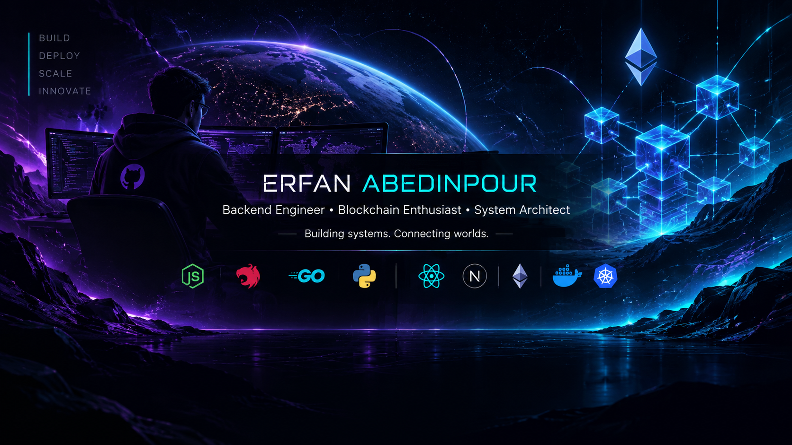

<!-- =====================================================
     ERFAN ABEDINPOUR | DEVELOPER PROFILE
     Theme: Midnight Cyber-Tech
     Backend | Blockchain | Architecture
====================================================== -->

<div align="center">

<!-- CUSTOM HERO BANNER -->


<br/>

<!-- ANIMATED INTRO -->


<br/><br/>

<a href="https://github.com/ErfanAbedinpour">
  
</a>
<a href="https://t.me/ErfanAbedinpour">
  
</a>
<a href="mailto:erfan.wtf44@gmail.com">
  
</a>
<a href="https://www.instagram.com/erfanabedinpour6">
  
</a>

<br/><br/>


</div>

---

<div align="center">

## `01 / ABOUT ME`

### Building systems. Connecting worlds.

</div>

I'm **Erfan Abedinpour**, a software developer focused on backend engineering, system architecture, and blockchain-related technologies.

My main playground is **Node.js, NestJS, and TypeScript** — building typed services, designing APIs, implementing real-time communication, and developing the infrastructure behind modern applications.

But my interests go beyond traditional backend development.

I'm also interested in **Blockchain and decentralized systems**, especially on-chain transfers, transaction flows, and shared state between multiple parties that need to trust the same data.

When a product needs a face, I work with React and Next.js. When a service needs to stay small and efficient, I explore Go. And when a task needs automation, Python is always nearby.

I believe good architecture isn't about making everything complicated.

It's about making the right decisions before complexity becomes a problem.

```typescript
const erfan = {
  name: "Erfan Abedinpour",

  role: "Software Engineer",

  focus: [
    "Backend Engineering",
    "Blockchain & Web3",
    "System Architecture"
  ],

  backend: [
    "Node.js",
    "NestJS",
    "Go",
    "Python"
  ],

  frontend: [
    "TypeScript",
    "JavaScript",
    "React",
    "Next.js"
  ],

  technologies: [
    "GraphQL",
    "WebSocket",
    "Socket.IO",
    "Docker"
  ],

  architecture: [
    "Domain-Driven Design",
    "Microservices",
    "Distributed Systems"
  ],

  blockchain: [
    "On-chain Transfers",
    "Transaction Flows",
    "Shared & Verifiable State"
  ],

  philosophy: "Build with purpose. Scale with reason."
};
```

---

<div align="center">

## `02 / TECHNOLOGY STACK`

*The tools behind the systems I build.*

</div>

### ⚙️ Backend Engineering

<div align="center">


<br/><br/>


</div>

### ⛓️ Blockchain & Web3

<div align="center">


</div>

### 🎨 Frontend Engineering

<div align="center">


</div>

### 🧠 Development Environment

<div align="center">


</div>

---

<div align="center">

## `03 / WHAT I BUILD`

*Different layers. One engineering mindset.*

</div>

<table>
<tr>
<td width="50%" valign="top">

<h3>⚙️ Backend Systems</h3>

Building reliable application infrastructure.

- NestJS & Node.js
- Go services
- GraphQL & REST APIs
- WebSocket & Socket.IO
- Typed service architecture
- Docker

</td>
<td width="50%" valign="top">

<h3>⛓️ Blockchain & Web3</h3>

Exploring systems beyond centralized infrastructure.

- On-chain transfers
- Transaction flows
- Shared state between participants
- Verifiable data
- Blockchain integrations
- Decentralized systems

</td>
</tr>

<tr>
<td width="50%" valign="top">

<h3>🏗️ Software Architecture</h3>

Designing systems that remain maintainable as they grow.

- Domain-Driven Design
- Microservice boundaries
- Distributed systems
- Service communication
- Modular architecture

</td>
<td width="50%" valign="top">

<h3>◈ Frontend Development</h3>

Building interfaces that bring products to life.

- TypeScript & JavaScript
- React
- Next.js
- Modern web interfaces
- API integration

</td>
</tr>
</table>

---

<div align="center">

## `04 / CURRENTLY EXPLORING`

*Always learning. Always building.*

</div>

```yaml
current_focus:

  backend:
    - Advanced NestJS architecture
    - Domain-Driven Design
    - Typed and maintainable services

  blockchain:
    - On-chain transaction flows
    - Shared state between participants
    - Blockchain system integration

  architecture:
    - Meaningful microservice boundaries
    - Distributed system communication
    - Scalable service design

  exploration:
    - Go for lightweight backend services
    - Python for automation

engineering_principles:
  - Keep things simple
  - Design around business domains
  - Avoid unnecessary complexity
  - Choose architecture based on actual needs
```

---

<div align="center">

## `05 / GITHUB ANALYTICS`

*Some numbers behind the code.*

<br/>


<br/><br/>


</div>

---

<div align="center">

## `06 / BEYOND THE CODE`

### Think in systems. Build with intention.

I enjoy working on problems where software engineering meets architecture, real-time communication, and decentralized technology.

Whether it's a backend service, a distributed system, or a blockchain-related solution, I'm interested in understanding how things work beneath the surface.

<br/>

**Have an interesting idea or system to build? Let's connect.**

<br/>

<a href="https://t.me/ErfanAbedinpour">
  
</a>

<a href="mailto:erfan.wtf44@gmail.com">
  
</a>

<br/><br/>


<sub>ERFAN ABEDINPOUR © 2026 · ENGINEERED WITH CURIOSITY</sub>

</div>
